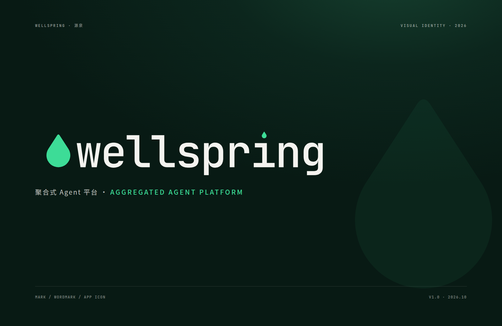

# 品牌资产

**当前选中：Chorus 和声** → [`chorus/`](chorus/README.md)。名字与图形的探索过程在 [`concepts/`](concepts/README.md)。

下面这份是 v1「Wellspring · 水滴」的说明，留作历史，不再作为当前标志。

标志、字标与图标资产。v1.0 · 2026.10。



## 概念

wellspring 是「井」，也是不断涌出的「泉」。平台叫源泉：所有能力从一个源头涌出，又汇回同一个入口。

标志取一滴水。它与文字共用一条基线；在单字标里，它就是 `i` 上的那一点——**泉眼，既是泉水流出的地方，也是字符的眼睛**。所以标志与文字永远同形：同一段路径，放大成图标，缩到 0.155 em 就是字母上的点。

- 深林 `#0F2F24` 是水的深度，也是界面底色。
- 泉 `#3DDC97` 只给涌出的部分：强调、焦点、光标。
- 一条基线，把插件、模型、会话收进同一个字。

## 构成

| 项 | 值 |
| --- | --- |
| 画布 | 32 × 32 网格 |
| 水滴 | 高 24.4 · 宽 17.2（1.42） |
| 圆身 | 正圆 r = 8.6，两侧为圆的切线 |
| 尖端 | 1.6 圆角，16 px 时不糊成锐点 |
| 字标 i 点 | 同一路径 × 0.155 em |

圆身是正圆、两侧是切线，所以尖端角度可以按尺寸整除；字标与标志共用同一段 `path`，任何尺寸下都是同一滴水。

## 文件

| 路径 | 内容 |
| --- | --- |
| `cover.png` | 封面 / 社交图，1600 × 1040 |
| `brand-board.html` | 自包含品牌板（字体已内嵌，可离线打开） |
| `brand-board.png` | 品牌板位图，1600 × 7404（[打开](brand-board.png)） |
| `logo/wellspring-symbol*.svg` | 单字标：墨绿 / 泉绿 / `currentColor` |
| `logo/wellspring-wordmark*.svg` | 字标：浅底 / 深底 / 单色，已转曲 |
| `logo/wellspring-lockup-horizontal*.svg` | 横排组合：浅底 / 深底 / 单色 |
| `logo/wellspring-lockup-stacked*.svg` | 堆叠组合：浅底 / 深底 / 单色 |
| `logo/wellspring-lockup-bilingual*.svg` | 中英双语组合：浅底 / 深底 |
| `logo/wellspring-app-icon*.svg` | 应用图标：深底主版 / 泉绿副版 |
| `logo/wellspring-favicon.svg` | 16–32 px 反白图标 |
| `png/` | 19 个位图导出（透明底 SVG 渲染、图标各尺寸、favicon 16/32/48） |
| `scripts/build-logo.py` | 从几何与字形生成全部 SVG |
| `scripts/export-png.py` | headless Chrome 导出位图 |
| `scripts/build-board.py` | 生成品牌板 HTML / PNG |
| `scripts/fonts/` | JetBrains Mono 500/600、Noto Sans SC 子集（构建用，OFL） |

## 色彩

| 名称 | HEX | 用途 |
| --- | --- | --- |
| 深林 | `#0F2F24` | 主色：深色界面、图标底、标题 |
| 泉 | `#3DDC97` | 深底上的强调：标志、焦点、光标 |
| 深泉 | `#067A5B` | 浅底上的强调（与 `#F4F3EF` 对比 7.1:1） |
| 骨 | `#F4F3EF` | 浅底与深底上的文字；不用纯白 |

强调色按底色配对：**深底用泉，浅底用深泉**。不要把 `#3DDC97` 直接放在 `#F4F3EF` 上做文字或小图形——对比只有 1.3:1。图标在 ≤ 32 px 时用反白版本（泉绿底 + 深林滴），在标签页里最先被认出来。

## 字体

- 字标：JetBrains Mono **Medium 500**，字距 −0.032 em，i 点换成标志；已转曲，用标不依赖字体。
- 中文：Noto Sans SC 500 / 700。
- 产品界面目前用系统等宽字体栈。要让字标与界面字形一致，建议前端随包引入 JetBrains Mono（OFL）。
- UI 里的标志不用加粗、不用斜体、不加框。

## 组合与留白

- 横排：标志高 0.77 em，与字标间距 0.38 em，共用基线。
- 堆叠：标志居中于字标上方，间距 0.3 em。
- 双语：横排 + `源泉`，用于中文语境。
- 留白：四周最小 **0.5 x**（x = 标志高度），标志与文字之间不小于 0.38 em。
- 最小尺寸：单字标 **16 px**；横排 **≥ 120 px 宽**；再窄改用堆叠或单字标。

## 误用

不要拉伸、旋转、换色或做渐变、加阴影发光、描边空心、放在低对比底色上。深底用反白版，浅底用墨绿版；标志不要放进别的形状里再裁切。

## 重新生成

```bash
pip install fonttools
python3 scripts/build-logo.py     # logo/*.svg
python3 scripts/export-png.py     # png/*.png       需要 google-chrome
python3 scripts/build-board.py    # brand-board.html / brand-board.png
```

- `build-logo.py` 用 `scripts/fonts/` 里的 JetBrains Mono 500/600（已随附）和 Noto Sans SC 子集（只有 `源泉` 两字）。
- `build-board.py` 需要完整的 Noto Sans SC：把 `NotoSansSC-{400,500,700}.ttf` 放进 `brand/.fontcache/`（字体太大，没有随附）。

## 在项目里使用

- **站点图标**：把 `logo/wellspring-favicon.svg` 内联进 `plugins/wellspring-web/src/assets/favicon.ts` 的 `FAVICON_SVG`，或把该文件作为 `favicon.svg` 放到站点根目录。
- **侧栏 / 顶栏**：深底用 `logo/wellspring-lockup-horizontal-reversed.svg`，或单字标 + 14 px 的 `wellspring`（JetBrains Mono）。
- **登录页 / 空状态**：`logo/wellspring-symbol-reversed.svg` 放大到 64–96 px。
- **文档 / 海报**：用 `png/` 里的 1600 px 版本；印刷与任意缩放用 `logo/` 里的 SVG。

## 许可

- 标志与字标：随 Wellspring 项目使用。
- JetBrains Mono、Noto Sans SC：SIL OFL 1.1，见 `scripts/fonts/OFL-*.txt`。
