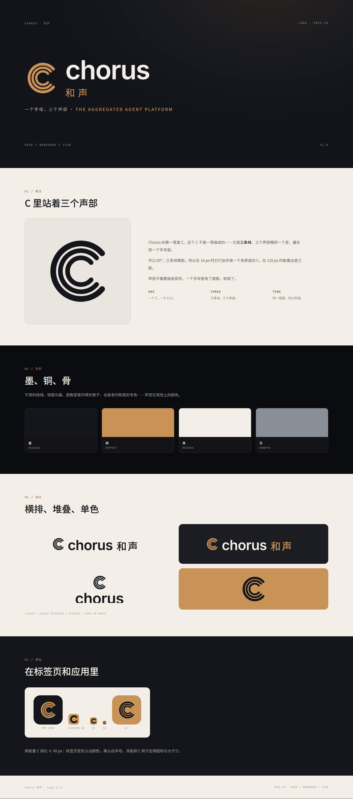

# Chorus 和声 · Logo v1.0



## 重设计（v2，待定）

[redesign.png](redesign.png) 里是六个 C 的方向（三股 / 涨落 / 三重影 / 和弦在内 / 缎带 / 不写 C），推荐 **B · 涨落**：一个 C，中间厚、两头收，像一次声音的涨落。当前 `logo/` 里的仍是 A · 三股。

## 概念

Chorus 的第一笔是 C。这个 C 不是一笔画成的——它是**三条线**：三个声部唱同一个音，叠在同一个字母里。开口 80°，三条线等距，所以 16 px 时它们并成一个有厚度的 C，128 px 时能看出是三股。

声音不需要画成音符。一个字母里有了层数，就够了。

- **ONE** — 一个 C，一个入口。
- **THREE** — 三条线，三个声部。
- **TUNE** — 同一弧度，所以同调。

## 构成

| 项 | 值 |
| --- | --- |
| 画布 | 32 × 32 网格 |
| 外弧 | r 10.8 · 线宽 2.2 |
| 中弧 | r 8.0 · 线宽 1.8 |
| 内弧 | r 5.2 · 线宽 1.8 |
| 开口 | 80°（40° → 320°） |
| 小尺寸变体 | 单弧 r 7.8 · 线宽 4.4（≤ 24 px） |

## 色彩

| 名称 | HEX | 用途 |
| --- | --- | --- |
| 墨 | `#14161B` | 主色：深色界面、图标底 |
| 铜 | `#C99357` | 强调：深底上的标志、焦点、光标 |
| 骨 | `#F3EFE6` | 浅底与深底上的文字；不用纯白 |
| 灰 | `#8A8F96` | 次级信息 |

铜底墨 C 用在 ≤ 48 px：标签页里先认出颜色，再认出字母。深底铜 C 用于应用图标与大尺寸。

## 字体

- 字标：**Inter SemiBold (600)**，字距 −0.02 em，已转曲，用标不依赖字体。
- 中文：**Noto Sans SC Medium**（和声）。
- 16–24 px 用 `chorus-symbol-small.svg`（单弧粗 C），三股在这个尺寸会糊。

## 组合与留白

- 横排：标志高 0.86 em，与字标间距 0.30 em，共用基线；双语时字标后接「和声」。
- 堆叠：标志居中于字标上方，间距 0.22 em。
- 留白：四周 ≥ **0.5 x**（x = 标志高度）。
- 最小尺寸：单字标 **16 px**（小尺寸变体）；横排 **≥ 120 px 宽**。

## 文件

| 路径 | 内容 |
| --- | --- |
| `logo/` | 16 个 SVG：单字标（墨/铜/骨/单色/小尺寸）、字标、横排·堆叠·单色组合、应用图标、favicon |
| `png/` | 12 个位图：标志 512、字标 1200、组合 1600、图标 1024、favicon 16/32/48 |
| `logo-sheet.png` / `.html` | 一页说明：概念、色彩、组合、图标 |
| `scripts/build-logo.py` | 从几何与字形重新生成全部 SVG |
| `scripts/fonts/` | Inter 600、Noto Sans SC 子集（和声）、JetBrains Mono 500 + OFL 许可 |

## 重新生成

```bash
pip install fonttools
python3 scripts/build-logo.py      # logo/*.svg
```

`png/` 与 `logo-sheet.png` 用 headless Chrome 从 SVG / HTML 导出，需要 `google-chrome`。

## 在项目里使用

- **站点图标**：`logo/chorus-favicon.svg`（铜底墨 C），16/32/48 的 PNG 在 `png/`。
- **侧栏 / 顶栏**：`logo/chorus-lockup-dark.svg`；浅底用 `logo/chorus-lockup.svg`。
- **应用图标**：`png/chorus-app-icon-1024.png`（深底铜 C）。
- **单色场景**：`logo/chorus-lockup-mono.svg`（`currentColor`）。

## 许可

- 标志与字标：随 Chorus 使用。
- Inter、Noto Sans SC、JetBrains Mono：SIL OFL 1.1，见 `scripts/fonts/OFL-*.txt`。
