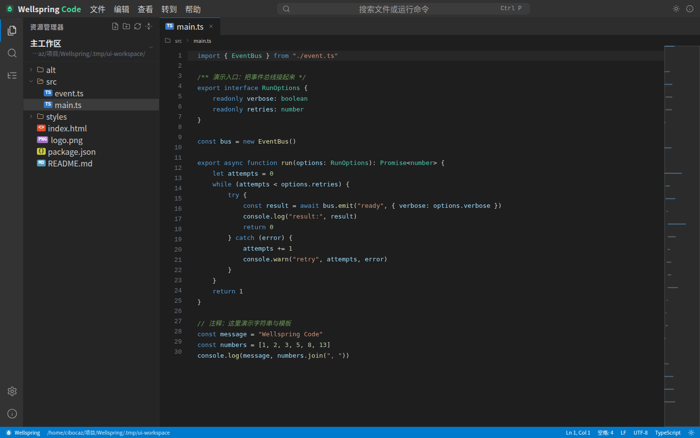
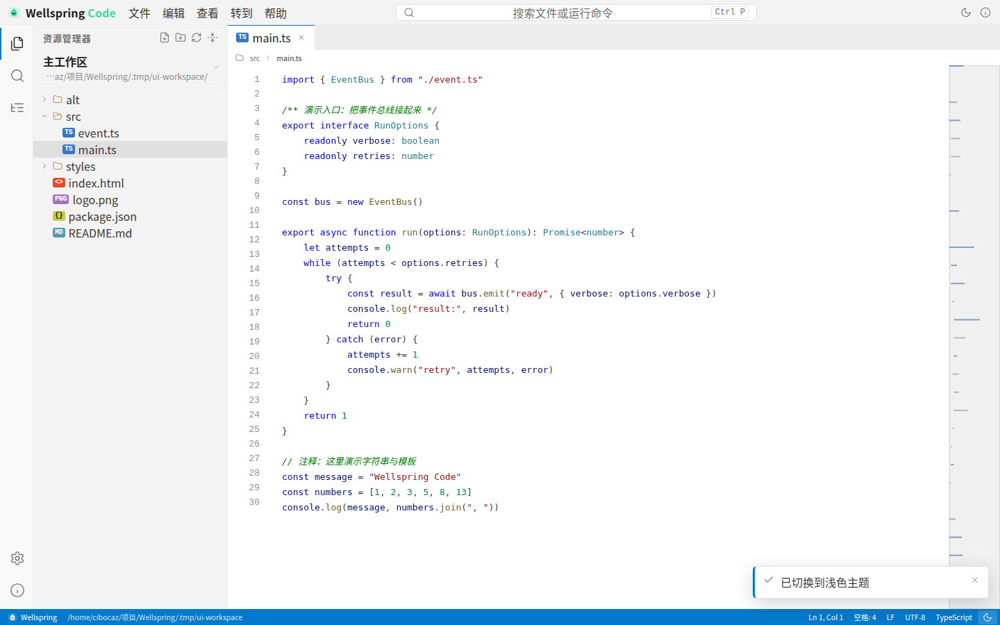
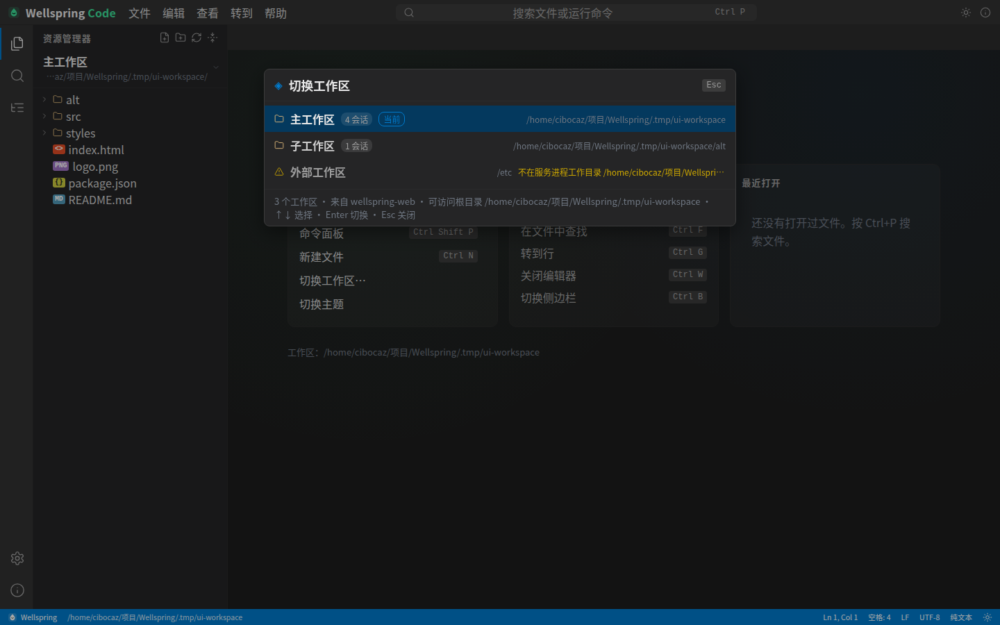

# wellspring-code

浏览器里的 VS Code 风格代码编辑器。工作区列表来自 Wellspring 宿主的注册表（`api.workspaces`），
不依赖其它插件；资源管理器、标签页、语法高亮、缩略图、搜索、命令面板、Markdown 预览全部由插件自己提供，
不依赖外部 CDN 与前端构建步骤。HTTP 服务器由 `wellspring-http` 插件统一创建。



<details>
<summary>浅色主题</summary>



</details>

## 加载

插件依赖 `wellspring-http`（HTTP 服务器由它统一创建），两个都要链接；`wellspring-web` 是可选的
（装了会多一个侧栏入口）：

```bash
wellspring plugin link plugins/wellspring-http
wellspring plugin link plugins/wellspring-code
# 可选：网页聊天界面（同时给 code 插件加侧栏入口）
wellspring plugin link plugins/wellspring-web
wellspring start
```

打开 `http://127.0.0.1:8788`（与 Web 插件默认的 `8787` 不冲突）。装了 Web 插件时，启动时会通过事件
总线注册一个 `nav-bottom` 入口：侧栏最下方显示「代码编辑器」，链接指向本服务的 `host:port`；
没装 Web 也不影响编辑器本身。

控制台需要真 tty，宿主按下面顺序挑后端（都在宿主进程里，插件只发 RPC）：

| 顺序 | 后端                                             | 条件                                                                     |
| ---- | ------------------------------------------------ | ------------------------------------------------------------------------ |
| 1    | `node-pty` 原生模块                              | 根目录 `package.json` 的 optionalDependencies，`pnpm pty:build` 构建成功 |
| 2    | `python-pty`（内置 `src/sandbox/pty-bridge.py`） | 本机有 `python3` 且带 `pty` 模块                                         |
| 3    | 命令模式                                         | 上面都不满足，退回一次性命令                                             |

`node-pty` 没有 linux 预编译包，装它要跑 node-gyp；node-gyp 在代理环境里下载 Node 头文件
可能失败，所以它是 **optionalDependencies**：`pnpm install` 不会因为它失败，
控制台会自动退回 python 后端。想用原生后端就构建一次：

```bash
pnpm pty:build                             # 用本机 Node 自带的 include/node 头文件编译
curl -s localhost:8788/api/console/state   # 看实际后端与不可用原因
```

python 后端用 `os.openpty()` 真开 tty，`TIOCSWINSZ` 同步尺寸，效果与 node-pty 一致；
差别只在实现依赖。

已经运行服务时改插件需要重启：

```bash
wellspring stop
wellspring start
```

文件能力来自宿主的 `workspaceFs`，根目录是**服务进程的当前目录**。所以要先进入一个能覆盖目标工作区的目录再启动服务，例如：

```bash
cd /home/me            # 覆盖 /home/me 下的所有项目
wellspring start
```

工作区列表来自宿主的 `api.workspaces`（`<dataDir>/workspaces.json`），见下一节。

## 工作区

工作区是宿主级概念：`wellspring-code` 通过 `api.workspaces.list()`（需要 `hostApi: workspaces`）
读取 `<dataDir>/workspaces.json` 里的注册表，不再依赖其它插件的数据目录：

- 只读取注册表字段：`id` / `name` / `root` / `lastSeenAt`
- 不读取其它插件的密码、会话或数据目录
- 注册表里的每个工作区都会计算「是否在当前服务可访问」：根路径必须落在服务进程工作目录内，
  否则在切换列表里置灰并说明原因
- 点击侧边栏的工作区标题、状态栏里的路径，或运行「切换工作区…」命令打开切换面板；
  支持方向键选择、Enter 切换
- 切换时会先处理未保存的编辑器（保存并切换 / 放弃更改 / 取消），然后重新加载文件树
- 标签页、最近打开、目录展开状态、当前工作区都按工作区分别保存在浏览器 localStorage
- 每个浏览器窗口通过 `x-workspace-id` 请求头发送自己选中的工作区，多个窗口互不影响；
  没有该请求头时回退到服务端当前工作区（默认取与服务进程工作目录相同的工作区）
- 宿主首次加载注册表时会把旧版 `wellspring-web` 插件数据目录里的工作区索引迁移过来，
  升级后已有工作区不丢



```text
workbench 侧栏
  └─ 工作区标题（点击切换）
       ├─ 主工作区    /home/me/project-a       当前
       ├─ 子工作区    /home/me/project-a/web
       └─ 外部工作区  /srv/data                当前实例不可访问
```

## 配置

`<configDir>/plugins/wellspring-code.json`：

```json
{
    "host": "127.0.0.1",
    "port": 8788,
    "readOnly": false,
    "tls": null
}
```

| 字段          | 默认        | 说明                                                               |
| ------------- | ----------- | ------------------------------------------------------------------ |
| `host`        | `127.0.0.1` | 监听地址；改成 `0.0.0.0` 前先设置访问密码（见「远程访问」）        |
| `port`        | `8788`      | 端口；`0` 表示随机端口                                             |
| `readOnly`    | `false`     | 只读模式，工作区写接口返回 `403`（认证与密码接口不受影响）         |
| `tls`         | `null`      | 可选 HTTPS：`{ "cert": "PEM 文本", "key": "PEM 文本", "ca": "…" }` |
| `allowRemote` | `false`     | 兼容项：还没有密码时允许先绑非回环地址；此时远程请求仍会被拒绝     |

没有设置访问密码时，非回环地址会被拒绝并回退到 `127.0.0.1`（除非显式 `allowRemote: true`）。

### 远程访问

1. 本机打开 `http://127.0.0.1:8788`，进「设置 → 访问密码」设置密码（至少 6 位）
2. 插件配置里把 `host` 改成 `0.0.0.0`（或指定网卡地址）；要 HTTPS 就同时填 `tls`
3. 重启 `wellspring`
4. 远程浏览器打开 `http://<主机地址>:8788`，输入访问密码

没设密码时，绑定 `0.0.0.0` 后远程只会看到「远程访问未启用」提示页，API 一律 `403`；
首次设置密码必须在本机完成。

HTTP 直接暴露时密码会明文经过网络。建议用内置 `tls`，或把插件放在 TLS 反代后面：
Caddy 的 `reverse_proxy 127.0.0.1:8788`、Tailscale Serve、Cloudflare Access 都可以。

## 功能

- **工作区**：从 `wellspring-web` 索引快捷打开工作区，显示会话数；不可访问的工作区置灰说明原因；
  切换工作区时处理未保存文件，标签与最近打开按工作区隔离
- **资源管理器**：懒加载目录树、目录优先排序、按扩展名着色的文件徽标、展开状态持久化、
  新建文件/文件夹、重命名、删除、复制相对/绝对路径、在树中定位当前文件
- **编辑器**：textarea 输入 + 高亮层叠渲染；行号、当前行高亮、缩略图、语法高亮、
  Tab 缩进/反缩进、Enter 自动缩进、括号与引号自动配对、Backspace 成对删除；
  语法高亮只渲染视口上下几百行，并按行缓存分词状态：改一行只重算一行、只改一个 DOM 节点，
  整个文档再长，输入时的着色开销都只有一行；
  中文输入法组合期间 textarea 只装光标所在行并贴到该行位置，
  避免原生 textarea 每次组合更新重排整篇文本，结束时拼回全文并补一次完整渲染
- **浏览位置记忆**：按工作区 + 文件路径记住滚动位置与光标选区，刷新页面、重新打开文件或切回标签时恢复
- **自动补全**：输入标识符字符（如 `c`）即自动弹出，候选来自当前语言的关键字 / 类型 / 字面量与文件内出现过的标识符，
  前缀匹配、忽略大小写、关键字与短词优先；`Ctrl+Space` 手动打开，`↑` / `↓` 选择，
  `Tab` / `Enter` 接受，`Esc` 关闭；浮层按光标像素位置定位，靠近视口边缘时自动上翻/左收
- **语法诊断**：轻量结构检查（括号配平、字符串/注释未闭合、JSON 解析错误），支持 C 家族 / Python / Shell / CSS；
  问题面板（活动栏「问题」）与状态栏计数，点击问题跳到对应行列；编辑器里按字符宽度画波浪线，
  停止输入 250ms 后重算，400 KB 以上的文件跳过
- **括号配对与缩进参考线**：光标挨着括号时高亮配对的两个括号（字符串/注释里的括号不参与），
  缩进参考线画在 canvas 上，滚动时只重绘可见行，不增加 DOM 节点
- **源码管理**：活动栏「源码管理」显示分支、ahead/behind、暂存的更改 / 更改 / 未跟踪三组文件；
  点文件打开，点「差异」在新标签里打开左右并排的差异窗口（只读、红绿着色、带行号，可刷新 / 回到源文件）；
  每行用 `+` / `−` 图标按钮暂存或取消暂存，表头可「全部暂存 / 全部取消」；资源管理器里给改动文件标 M / A / D / ?；
  Git 写操作仅限暂存与取消暂存（`git add` / `git restore --staged`），不提交、不切换分支
- **符号导航**：`Ctrl+Shift+O` 文件内符号搜索（复用大纲解析），输入过滤、Enter 或点击跳到对应行；
  `Ctrl+Alt+T` 工作区符号搜索：服务端扫描工作区文本文件建轻量索引并缓存 10 秒，跨文件跳到文件 + 行，
  单次最多扫描 800 个文件、单文件 512 KB、1.2 秒时间预算，超出时标记索引已截断；
  `Ctrl+Shift+G` / `Ctrl+点击` 转到定义：先查当前文件，再查已打开的标签，找不到时给出提示
- **访问认证**：可选的单用户访问密码；设置后所有 API 要求登录，带登录页、退出登录与改密；
  密码用 scrypt 哈希存插件数据目录，会话 token 只在内存；HTTPS 下 cookie 带 `Secure`
- **移动端**：点左侧栏里的文件或切换工作区后侧栏自动收起；抽屉收起后完全移出屏幕右侧；
  编辑器支持触摸滚动；点控制台输出区会聚焦不可见的输入框以唤起软键盘（回车/退格/中文输入转发给 PTY）；
  工作台高度跟随 `visualViewport`，键盘弹出时不把内容挡在下面
- **标签页**：多文件、未保存圆点、中键关闭、脏文件关闭确认（保存 / 不保存 / 取消）、会话恢复
- **查找与替换**：`Ctrl+F` 文件内查找，匹配计数、上一个/下一个；`Ctrl+H` 展开替换行，
  支持替换当前与全部替换（一次整体编辑，可撤销）；`Ctrl+G` 转到行
- **搜索**：文件名模糊搜索（快速打开）与工作区全文搜索，支持区分大小写、正则、结果按文件分组、点击跳转
- **命令面板**：`Ctrl+Shift+P`，按类别筛选；菜单栏（文件 / 编辑 / 查看 / 转到 / 帮助）复用同一套命令
- **预览**：Markdown 渲染（标题、列表、代码块、表格、引用、链接）、图片预览、二进制文件下载
- **控制台**：左下角活动栏的终端图标或 `Ctrl+Backquote` 开合。装上 `node-pty` 时是**真 tty**：
  键盘直通（vim / top / htop 可用）、ANSI 颜色与光标控制、可随窗口调整尺寸；
  没装时自动退回一次性命令模式（宿主 `exec`）
- **终端光标**：实心反色块光标（闪烁），终端失焦时变成空心框；CJK / emoji 按两格记账，
  光标位置按同字体量出的文字宽度定位，含中文的提示符或输出下光标不会压住字符
- **终端高度**：拖动控制台顶部的分隔条调整高度（`row-resize`），双击分隔条复位到 240px，
  聚焦分隔条后可用 `↑` / `↓`（`Shift` 为 48px 步长）微调；尺寸保存在设置里，重启后保留。
  最小高度按字号动态计算，保证至少 6 行可见
- **终端生命周期**：隐藏面板（右上角 `×`）、切换标签、刷新页面都不会杀掉 shell；会话存在插件服务进程里，
  结束终端要显式点标签上的 `×` 或工具栏的垃圾桶按钮（两者都是关闭当前终端并移除标签），
  服务重启时统一清理。页面刷新从 `GET /api/console/list` 恢复还活着的会话并重放最近 64KB 输出。
  最多同时 4 个会话
- **终端清屏**：命令面板「清屏终端」或 `Ctrl+Shift+K`（垃圾桶按钮留给关闭终端，避免误清屏）
- **终端选择与剪贴板**：鼠标拖选、双击选词、三击选行；只有文字参与选中，不含行尾空白。
  `Ctrl+C` 在有选中时复制（不再发 SIGINT，无选中仍是中断）、`Ctrl+Shift+C` 复制、`Ctrl+V` 粘贴
- **终端回看**：滚轮 / `PageUp` / `PageDown` 翻 scrollback；右侧细滚动条可拖动或点击跳转，
  回看时右下角出现「↓ 回到底部」，期间有新输出会变成「↓ 有新输出」；回看时块光标自动隐藏
- **终端退出**：shell 退出后在屏上显示退出码（非 0 为红色），输入框提示「会话已退出，按 Enter
  重新开始」，Enter 原地重开会话
- **状态栏**：Git 分支、光标位置、选中字符数、缩进、换行符、编码、语言；保存后有短暂提示
- **主题与设置**：深色 / 浅色 / 跟随系统；界面字号（紧凑 / 默认 / 较大 / 大）、代码字号、
  Tab 宽度、缩略图、面包屑、外部修改检测；设置存在浏览器 localStorage
- **外部修改检测**：轮询打开文件的 mtime；文件在磁盘上变化且没有本地修改时自动重新加载，
  本地有未保存修改时标记冲突，保存返回 `409` 后可以选择重新加载或覆盖
- **安全头**：严格 CSP（`default-src 'none'`），HTML 不含内联脚本/样式，写接口校验 JSON、大小与同源 `Origin`

## 快捷键

| 快捷键                | 作用                         |
| --------------------- | ---------------------------- |
| `Ctrl+P`              | 快速打开文件                 |
| 侧栏工作区标题        | 切换工作区                   |
| `Ctrl+Shift+P`        | 命令面板                     |
| `Ctrl+S`              | 保存当前文件                 |
| `Ctrl+Shift+S`        | 全部保存                     |
| `Ctrl+F`              | 在文件中查找                 |
| `Ctrl+H`              | 查找并替换                   |
| `Ctrl+G`              | 转到行                       |
| `Ctrl+Shift+O`        | 文件内符号搜索               |
| `Ctrl+Alt+T`          | 工作区符号搜索               |
| `Ctrl+Shift+G`        | 转到定义                     |
| `Ctrl+点击`           | 转到定义（鼠标）             |
| `Ctrl+Space`          | 手动打开自动补全             |
| `Tab` / `Enter`       | 补全浮层打开时接受候选       |
| `Ctrl+N`              | 新建文件                     |
| `Ctrl+B`              | 切换侧边栏                   |
| `Ctrl+W`              | 关闭编辑器                   |
| `Ctrl+Tab`            | 下一个编辑器                 |
| `Ctrl+Shift+E`        | 资源管理器                   |
| `Ctrl+Shift+F`        | 搜索                         |
| `Ctrl+Shift+V`        | 预览 Markdown                |
| `Ctrl+Backquote`      | 开合控制台                   |
| `Ctrl+C`              | 终端：有选中时复制，否则中断 |
| `Ctrl+Shift+C`        | 终端：复制选中内容           |
| `Ctrl+V`              | 终端：粘贴到 PTY             |
| `PageUp` / `PageDown` | 终端：回看 scrollback        |
| `Esc`                 | 关闭查找 / 菜单 / 浮层       |

## 路由

| 方法   | 路径                  | 说明                                             |
| ------ | --------------------- | ------------------------------------------------ |
| GET    | `/`                   | 页面外壳                                         |
| GET    | `/assets/app.css`     | 样式表                                           |
| GET    | `/assets/app.js`      | 客户端脚本（高亮、编辑器、UI 三个片段拼成一份）  |
| GET    | `/favicon.svg`        | 图标                                             |
| GET    | `/api/auth/state`     | 是否已设密码、当前是否登录、是否本机、是否 HTTPS |
| POST   | `/api/auth/login`     | 密码登录，成功后下发会话 cookie                  |
| POST   | `/api/auth/logout`    | 退出当前会话                                     |
| POST   | `/api/auth/password`  | 首次设置或修改密码（修改需要当前密码）           |
| GET    | `/api/state`          | 当前工作区根、名称、版本、只读、分支、宿主信息   |
| GET    | `/api/workspaces`     | 宿主工作区注册表与可访问性                       |
| POST   | `/api/workspace`      | 切换当前工作区 `{ id }`                          |
| GET    | `/api/host`           | 宿主状态、OS、目录与插件列表                     |
| GET    | `/api/tree?path=`     | 目录条目，含类型、大小、mtime、徽标与语言        |
| GET    | `/api/symbols?q=`     | 工作区符号索引（函数 / 类 / 标题等，可 limit）   |
| GET    | `/api/git/status`     | 只读 Git 状态：分支、ahead/behind、改动列表      |
| GET    | `/api/git/diff?path=` | 只读 unified diff，`staged=1` 查看已暂存差异     |
| POST   | `/api/git/stage`      | 暂存文件，`{ paths: string[] }`                  |
| POST   | `/api/git/unstage`    | 取消暂存，`{ paths: string[] }`                  |
| GET    | `/api/file?path=`     | 文本文件内容、mtime、EOL、缩进；二进制返回元信息 |
| GET    | `/api/raw?path=`      | 原始字节（图片预览 / 下载），上限 8 MiB          |
| GET    | `/api/stat?path=…`    | 批量 stat，用于外部修改轮询                      |
| POST   | `/api/file`           | 新建文件或目录                                   |
| PUT    | `/api/file`           | 保存文本，支持 `baseMtimeMs` 乐观并发校验        |
| DELETE | `/api/file?path=`     | 删除文件或目录                                   |
| POST   | `/api/rename`         | 重命名或移动                                     |
| GET    | `/api/search/files`   | 文件名模糊搜索                                   |
| GET    | `/api/search/text`    | 全文搜索，`case=1` / `regex=1`                   |
| GET    | `/api/term/history`   | 终端命令历史                                     |
| POST   | `/api/term/run`       | 启动命令，返回会话 id；`cwd` 只能落在工作区内    |
| GET    | `/api/term/poll`      | 拉取自上次 poll 后的新增输出                     |
| POST   | `/api/term/stop`      | 终止仍在运行的命令（命令模式会话）               |
| GET    | `/api/console/state`  | 控制台可用性、实际后端与不可用原因               |
| GET    | `/api/console/list`   | 仍存活的终端会话，页面刷新后据此恢复             |
| POST   | `/api/console/open`   | 打开 shell 会话，返回会话 id 与尺寸              |
| GET    | `/api/console/poll`   | 拉取自上次 poll 后的 PTY 输出（含 ANSI 序列）    |
| POST   | `/api/console/input`  | 键盘输入原样写入 PTY                             |
| POST   | `/api/console/resize` | 同步终端尺寸                                     |
| POST   | `/api/console/close`  | 结束 shell 会话                                  |

静态资源返回 `ETag`，带 `If-None-Match` 时返回 `304`；页面与 API 都是 `no-store`。
设置密码后，除认证接口外的所有 API 都要求会话 cookie；未登录返回 `401`。

## 限制

- 进程由宿主代跑：插件进程被 `access-guard` 禁止 `child_process`，
  控制台走 `api.pty`（node-pty 或内置 python 桥接），回退模式走 `api.exec`；`cwd` 都限制在当前工作区内
- 控制台是自制 VT 渲染：支持 SGR 颜色/字重、光标移动、擦除、滚动区域，
  不做鼠标上报与 24 位图元，六宫格绘图类程序（htop 的鼠标、图片预览）不完整；
  回退模式无 ANSI 解释，输出按纯文本追加，上限 2 MiB / 默认超时 120s
- 没有 LSP；语法高亮是插件自带的正则词法着色，语法诊断只做结构级检查（括号/字符串/注释/JSON），不做语义分析；
  转到定义只在当前文件与已打开的标签里按符号名查找；工作区符号索引是行级正则扫描（最多 800 文件 / 512 KB 单文件），不做类型解析
- 不使用 Monaco 等外部编辑器，避免引入打包步骤与 CDN 依赖；因此没有多光标与代码折叠
- 服务实例的文件根是启动时的当前目录；只有落在这个根内的 `wellspring-web` 工作区可以打开，
  根外的工作区在切换面板里置灰。想覆盖更大的范围，就在更上层目录启动服务
- 一次只能激活一个工作区；切换会关闭当前工作区的标签页（按工作区恢复）
- Git：`rev-parse` / `status` / `diff` 只读；写操作仅限暂存与取消暂存（`git add` / `git restore --staged`），
  不提交、不切换分支；工作区不在仓库、没装 git 或插件只读模式下会给提示 / 拒绝操作
- 单个文本文件上限 2 MiB，原始预览上限 8 MiB，全文搜索扫描上限 800 个文件 / 200 条结果
- 快速打开与全文搜索跳过 `node_modules`、`.git`、`dist`、`coverage` 等生成目录

## 安全

- 默认只监听回环地址；没有访问密码时只接受本机请求，非回环地址会被拒绝或回退
- 访问密码：scrypt 哈希存插件数据目录 `auth.json`；会话 token 只在进程内存，有效期 30 天，
  改密后全部失效；登录失败 5 次锁定 60 秒
- 会话 cookie 为 `HttpOnly` + `SameSite=Lax`，HTTPS 下追加 `Secure`；页面按登录态服务端渲染
- 可选内置 TLS；不配 TLS 又直接监听 `0.0.0.0` 时，密码与内容以明文经过网络，建议放在 TLS 反代后
- 所有路径都是相对工作区根的 POSIX 路径，拒绝绝对路径、`..` 与控制字符；宿主 `workspaceFs` 再做一次越界校验
- 严格 CSP：`default-src 'none'`、`script-src 'self'`、`style-src 'self'`、`img-src 'self' data: blob:`
- 写接口要求 `application/json`、限制请求体 4 MiB，并校验同源 `Origin`
- Markdown 预览只生成转义后的 HTML；链接仅放行 `http(s)` 与 `mailto`
- 工作区列表只来自宿主注册表（`api.workspaces`）；不读取其它插件的认证文件与会话内容，也不写对方的数据目录
- 插件数据目录只写 `auth.json`；编辑器设置仍在浏览器 localStorage

## 图标

除 Wellspring 自有 logo 外，界面图标来自开源图标库 [Lucide](https://lucide.dev)（ISC License），
版本 `lucide-static@0.468.0`。图标以内联 SVG 精灵的形式放在 `src/assets/icons.ts`，不请求外部
CDN；生成映射与完整许可证见该文件头部。

## 设计

- 令牌用 CSS 自定义属性，`[data-theme="light"]` 覆盖一套浅色值；默认深色
- UI 字号 token（`--font-size-xs: 1rem` … `--font-size-8xl: 3.7rem`）直接沿用
  `etheros-web/frontend/src/assets/styles/global.scss` 的定义；`html` 的基准字号默认 `1rem`，
  设置面板的「界面字号」改的是这个根字号，所有 rem token 一起等比缩放。
  徽标 / kbd 这类嵌套小字用 `em` 相对父级 token。编辑器代码字号仍由 `--code-size` 控制，互不影响
- 字体栈优先 JetBrains Mono / Cascadia Code / Fira Code，回退系统等宽与 UI 字体，不请求外部字体
- 编辑器采用 textarea + 高亮层叠：textarea 负责输入、选择与滚动，`<pre>` 平移同步着色，
  canvas 画缩略图
- 高亮层只渲染视口附近的行，用 transform 把这一片平移到「行首 + 行号」位置。
  整篇文档几十万字符时，把全部行做成几万个 span 再换 innerHTML，浏览器要重排整篇文本
  （4000 行实测一次输入后约 1s 才能重新上色）。C 家族（TS/JS/C/C++/Java/C#/Rust/Go/PHP/Swift）
  照 VS Code 的做法做**按行增量分词**：每行缓存「行首状态（普通 / 块注释 / 模板字符串）」
  和着色结果，编辑后先按公共前后缀换算出改动的行范围，只重分词这一行；如果行尾状态和缓存里
  下一行的行首状态一致，后面的行全部复用（输入普通字符只分词 1 行，只有输入块注释开头、
  未闭合字符串这类会改变后续状态的情况才向后传播）。渲染是一行一个 `.view-line` 元素，
  改哪行只改哪个元素的 innerHTML。实测每次按键只产生 1 处 DOM 改动，输入到颜色更新
  p50 ≈ 4ms、p90 ≈ 15ms（视口整片重算约 70ms，整篇分片约 1s），没有 50ms 以上的长任务；
  滚动时只要视口还在已渲染范围内就只平移不重渲染，滚出范围才在下一帧补渲染。
  没有行状态缓存的语言（Python/CSS/HTML/Markdown 等）仍走视口整片重算：先铺纯文本、
  60ms 停顿后上色
- 原生 textarea 里装几千行时，Chromium 每次 IME 组合更新都要重排整篇文本：4000 行、光标在文档
  后段时单次更新实测可达 1s 以上，高亮层的优化完全管不到这里。所以组合期间把 textarea
  缩成光标所在行（超长行只保留光标附近约 240 + 1200 字符），按行号与横向滚动量贴到该行真实位置，
  高亮层里的这一行用同底色遮罩盖住；组合结束把行文本拼回全文，再用 `execCommand insertText`
  重放一次提交，让这次中文输入仍然可以 `Ctrl+Z`。小文件、只读文件、带选区时退回原来的原生路径。
  组合期间点别的行没有全尺寸 textarea 接事件，会先结束组合再按坐标量出字符位置补上光标
- textarea 的文字是 `color: transparent`，可见文字全部来自高亮层，所以高亮层的内容是**正确性**问题，
  不是效果问题。上色要重新分词，按停顿合并；视口内容本体走 `requestAnimationFrame` 每帧填纯文本，
  键入停下后再换成着色结果。两者共用一个重置式计时器会出问题：按住退格时键盘重复间隔短于延时，
  计时器被反复清掉，画面停在旧内容上，松开按键才刷新
- 每次按键的固定开销也要压住：行号只在行数变化时重建（`gutterLines`），内边距一次量好缓存住
  （`refreshPadding`，隐藏时量到 0 就不采用），光标位置算一次传进当前行高亮，不再各自扫一遍全文
- 缩略图每行最多占 2.4px：100 行的短文件只占顶部约 240px，超过容器高度才按比例压缩，
  不会把整条缩略图拉满；点击 / 拖动按行定位并夹在首尾，鼠标停在缩略图上时滚轮也滚动编辑器
- 高亮层和 textarea 必须共用同一套字形度量：着色内容直接挂在 `<pre>` 下，字体、字号、行高
  与 textarea 完全一致（`.code-layer *` 也会强制继承）。若把内容包进 `<code>` 之类的元素，
  浏览器默认样式会换成系统 `monospace` 字体，字符宽度和行高都会变，代码字号放大后正文与
  选区、当前行高亮会逐行错位
- 前端没有构建步骤：`src/assets/` 下的模块用 `String.raw` 导出字符串，`src/assets/index.ts`
  把它们拼成 `/assets/app.js`，启动时计算 ETag。客户端片段里不能出现反引号与 `$` 花括号插值
- 工作区通过 `createScopedFs` 把 `workspaceFs/<prefix>` 包装成独立根；切换工作区只换前缀与文件服务实例，
  HTTP 层路径始终是相对当前工作区的
- 断点：980 / 760 / 560；760 以下侧边栏改为覆盖层，560 以下精简状态栏与缩略图
- `prefers-reduced-motion` 关闭动效，`prefers-contrast: more` 增强边框

## 开发

```bash
cd plugins/wellspring-code
../../node_modules/.bin/tsc --noEmit
```

```bash
cd ../..
node --test test/code-workspace.test.ts test/code-plugin.test.ts
```

- `code-workspace.test.ts` 覆盖路径规范化、读取/写入/冲突、重命名、搜索、索引与文件类型
- `code-plugin.test.ts` 用 `DirectBackend` 启动插件，并伪造宿主的 `workspaces.json`，
  覆盖 HTTP 路由、安全头、静态资源 ETag、写接口与工作区读取 / 切换
- 开发时可以用 `DirectBackend` 加载插件、把临时目录作为工作区，改完插件重启进程即可生效
